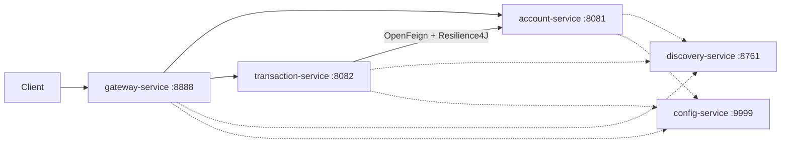

# Test ADRIA ENSET 2027 — Plateforme bancaire microservices

Projet réalisé dans le cadre de l'épreuve technique ADRIA (Architecture microservices, IA et développement full-stack).

La plateforme permet de consulter des comptes bancaires, d'enregistrer des transactions, de vérifier les règles métier et d'effectuer des virements entre comptes.

## Stack technique

- Java 21, Maven multimodule
- Spring Boot 4.1.2
- Spring Cloud 2025.1.4 (Eureka, Config Server, Gateway, OpenFeign, Resilience4J)
- Spring AI 2.0.2 (serveur et client MCP)
- Spring Data JPA + H2 (base en mémoire)
- Spring for GraphQL
- springdoc-openapi 3.2.0 (Swagger UI)
- Lombok

## Architecture



## Modules

| Module | Rôle | Port |
|---|---|---|
| `discovery-service` | Annuaire Eureka | 8761 |
| `config-service` | Configuration centralisée (profil `native`) | 9999 |
| `gateway-service` | Point d'entrée unique (Spring Cloud Gateway) | 8888 |
| `account-service` | Microservice métier : comptes bancaires | 8081 |
| `transaction-service` | Microservice métier : transactions et virements | 8082 |
| `event-consumer-service` | Consommateur Kafka (squelette) | — |
| `chatbot-service` | Agent Spring AI (squelette) | 8085 |

Les deux microservices métier suivent la même organisation de packages :

```
net.ayoub.<service>
├── entities          modèle JPA
├── repository        accès aux données
├── services          logique métier (appelée par REST et GraphQL)
├── controllers
│   ├── rest
│   └── graphql
├── dto
├── exceptions
└── clients           (transaction-service) client OpenFeign
```

## Modèle

**Account** : `id: UUID`, `customerReference: String`, `status: ACTIVE | BLOCKED`, `currency: String`, `balance: double`

**Transaction** : `id: UUID`, `accountId: UUID`, `amount: BigDecimal`, `currency: String`, `merchantCategory: String`, `country: String`, `createdAt: Instant`

Au démarrage, `account-service` crée 3 comptes de démonstration :

| Client | Statut | Devise | Solde |
|---|---|---|---|
| CUST-001 | ACTIVE | EUR | 5000 |
| CUST-002 | ACTIVE | MAD | 20000 |
| CUST-003 | BLOCKED | EUR | 1000 |

Les UUID changent à chaque redémarrage (base H2 en mémoire).

## Règles métier

Lors de la création d'une transaction, `transaction-service` :

1. vérifie que le montant est strictement positif et inférieur ou égal au plafond `bank.transaction.max-amount` (1000, fourni par le Config Server) ;
2. vérifie via OpenFeign que le compte existe et qu'il est `ACTIVE` ;
3. vérifie que la devise de la transaction correspond à celle du compte ;
4. consulte le solde du compte ;
5. enregistre la transaction, puis débite le compte dans `account-service`.

Le virement est orchestré par `transaction-service` : il vérifie les deux comptes (actifs, même devise), consulte le solde du compte source, débite la source puis crédite la destination.

Choix validés : le solde peut devenir négatif (le sujet ne demande pas de refuser un solde insuffisant).

## Tolérance aux pannes

Les appels de `transaction-service` vers `account-service` passent par un circuit breaker Resilience4J (`accountService`) :

- compte inexistant : HTTP 404 (ne compte pas comme une panne) ;
- `account-service` indisponible : HTTP 503 avec un message explicite. Aucune valeur par défaut n'est inventée, pour ne jamais valider une opération bancaire sans le compte réel.

## API REST

### account-service

| Méthode | URL | Description |
|---|---|---|
| GET | `/accounts` | Lister les comptes |
| GET | `/accounts/{id}` | Consulter un compte |
| GET | `/accounts/{id}/balance` | Consulter le solde |
| PUT | `/accounts/{id}/debit` | Débiter (`{"amount": 250}`) |
| PUT | `/accounts/{id}/credit` | Créditer (`{"amount": 100}`) |

### transaction-service

| Méthode | URL | Description |
|---|---|---|
| GET | `/transactions` | Lister les transactions |
| GET | `/transactions/account/{accountId}` | Transactions d'un compte |
| POST | `/transactions` | Créer une transaction |
| POST | `/transactions/transfer` | Virement entre deux comptes |

Exemple de création de transaction :

```json
{
  "accountId": "<uuid du compte>",
  "amount": 250.00,
  "currency": "EUR",
  "merchantCategory": "GROCERY",
  "country": "FR"
}
```

Exemple de virement :

```json
{
  "fromAccountId": "<uuid source>",
  "toAccountId": "<uuid destination>",
  "amount": 100.00
}
```

Swagger UI :

- http://localhost:8081/swagger-ui.html
- http://localhost:8082/swagger-ui.html

## API GraphQL

GraphiQL :

- http://localhost:8081/graphiql
- http://localhost:8082/graphiql

Exemples :

```graphql
query { accounts { id customerReference status currency balance } }

mutation { debit(id: "<uuid>", amount: 50) { id balance } }

mutation {
  createTransaction(request: {
    accountId: "<uuid>", amount: 250, currency: "EUR",
    merchantCategory: "GROCERY", country: "FR"
  }) { id amount createdAt }
}
```

## Gateway

| Route | Service |
|---|---|
| `/accounts/**` | `lb://account-service` |
| `/transactions/**` | `lb://transaction-service` |

Exemple : http://localhost:8888/accounts

## Partie IA Python

Le dossier `Test_Adria_Partie_AI` contient le notebook de détection de fraude (`fraude_bancaire.ipynb`) et le jeu de données `bank_transactions.csv`.
